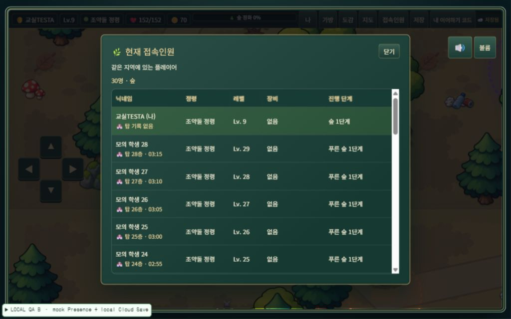

# 교실 운영 모드 · 개인 플레이 + 접속 정보 공유

작업일: 2026-10-24 · BUILD_VERSION: **2026.10.24.1** · SAVE_VERSION: **9 유지**

로컬 코드에 적용했다. commit / push / 배포는 하지 않았다. 기존 Cloud Save 1~3단계와 실제 학생 저장 데이터는 변경하지 않았다.

## 1. 변경 결과

| 항목 | 변경 후 |
|---|---|
| 월드 캐릭터 | 본인의 기존 캐릭터·정령·NPC 유지, 다른 학생 캐릭터 0개 |
| 위치/방향/moving Broadcast | 0건 |
| 이동 시작/종료·초기 위치 요청·요청 응답 | 0건 |
| 원격 캐릭터 DOM·이름표·그림자·보간·걷기 | 생성/실행하지 않음 |
| 접속인원 메뉴 | 기존 표·정렬·같은 지역 학생 목록 유지 |
| 학생 요약 | 기존 이름·정령·레벨·대표 장비·진행 단계 유지 |
| 탑 기록 | 기존 최고 층 + 연결된 기록 시간 유지 |
| 서버/학생 저장 | 변경 없음 |

`js/multiplayer-config.js`의 `movementEnabled:false`가 기본값이다. 설정 파일이 누락돼도 이동과 원격 렌더링은 비활성화된다. 기존 구현과 이미지 리소스는 삭제하지 않았으며, 복원이 필요할 때는 소스에서 명시적으로 opt-in하고 재검증할 수 있다.

비활성 경로는 단순 CSS 숨김이 아니다. movement는 채널 리스너·송신 타이머를 설치하지 않는다. remote renderer도 DOM·MutationObserver·애니메이션 프레임을 설치하지 않는다. 기존 원격 DOM이 있다면 제거하며 로컬 `#hero`는 건드리지 않는다.

## 2. Presence / 접속인원 / 탑 기록

기존 6개 `eco-forest / eco-river / eco-ocean / eco-city / eco-air / eco-climate` 채널 구분을 유지한다. Presence만으로 접속 목록을 갱신하므로 remotePlayers 생성에 의존하지 않는다. 학생 목록 UI는 재디자인하지 않았다.

기존 필드만 유지한다: `playerId`, `nickname`, `theme`, `joinedAt`, 기존 외형 필드, `spirit`, `level`, `equipment`, `progress`, `towerBestFloor`, `towerBestTime`. 좌표는 추가하지 않았고 cloudCode·세이브 전체·탑 도전 중 시간·과거 도전 이력은 포함하지 않는다.

탑 기록은 실제 `S.tower.best / bestTime` 요약을 계속 사용한다. 최고 기록에 변화가 없으면 추가 track이 없다.

## 3. track 최적화

로컬 상태 검사는 기존 500ms를 유지한다. 이 검사는 네트워크 전송이 아니다.

최초 참가와 SDK 재접속 후에는 즉시 track한다. 이후에는 마지막 전송 후 10초 간격으로 실제 요약/외형 변경을 모아 최신 값 한 번을 보낸다. 변경이 없으면 전송하지 않는다. 연속 변경이 있어도 대기를 계속 뒤로 미루지 않는 throttle 방식이다. 일반 변경 반영은 최대 약 10초 + 로컬 검사 간격 수준이며, 네트워크 지연은 별도다.

숨김 상태에서는 요약 변경을 새로 track하지 않는다. 전송 실패에는 간격을 늘려 재시도한다. 재연결 성공 시에는 서버 Presence를 복원하기 위해 동일 값이어도 한 번 재등록할 수 있다.

## 4. 접속 시점과 화면 전환

처음 참가하려면 실제 이름·기존 EC 번호·선택 정령·유효 테마가 있고, 월드 화면과 `Wd.ready`, `#plane`이 준비되어야 한다. 타이틀·이름·외형·스토리·정령 선택·조작 안내·초기 로딩에서는 참가하지 않는다.

월드 진입 이력을 메모리에만 기억해 이후 지도/완료 화면에서도 접속 정보를 유지한다. 전투·탑·미니게임·가방·접속인원 등 기존 월드 모달도 유지한다. `cloudload`/`clouddevice` 입력·선택 과정은 제외하며 성공적인 월드 복귀 후 다시 참가한다. Cloud Save의 saving/pending 상태는 참가 여부 판단에 사용하지 않는다.

지역이나 학생이 바뀌면 기존 채널을 먼저 제거한다. 정리에 실패하면 제거 재시도 전까지 새 채널을 만들지 않는다. 이전 채널의 늦은 콜백은 무시한다.

## 5. 숨김 탭 / 종료

- 위치 Broadcast는 모드 자체가 비활성화돼 숨김 여부와 관계없이 0건이다.
- 잠깐 숨김은 기존 Presence를 유지하고 metadata 전송을 멈춘다.
- 연속 약 30초 숨김이면 채널을 제거한다.
- 화면 복귀 시 한 번만 재참가하고 최신 요약을 등록한다.
- pagehide 시 검사 타이머·숨김 타이머를 정리하고 채널을 제거한다. pageshow는 검사 타이머를 하나만 복원한다.
- Cloud Save의 visibility/pagehide 저장 이벤트나 localStorage에는 손대지 않았다.

Android가 페이지 실행 자체를 얼리는 경우 30초 정리는 실행 재개 시점 또는 서버 연결 만료로 지연될 수 있다. 실기기에서 정확히 30초에 퇴장한다고 보장하지 않는다.

## 6. 재접속

`CHANNEL_ERROR` / `TIMED_OUT`은 SDK가 보유한 동일 채널의 복구를 기다린다. 이전처럼 3초 뒤 애플리케이션이 별도 채널을 중복 생성하지 않는다. `SUBSCRIBED` 복귀 시 Presence를 다시 등록한다.

종료된 `CLOSED` 채널이나 초기화/정리 실패만 제거 후 재시도한다. 대기는 5→10→20→40→60초 상한에 0~999ms 무작위 지연을 더한다. 채널 제거 중인 Promise도 공유해 중복 정리를 막는다. 장애 중에는 접속 목록만 비우고 개인 게임과 Cloud Save는 계속 동작한다.

채널 제거 실패 직후 같은 reconcile에서 새 채널을 만들 수 있는 분기를 검증 과정에서 발견했다. 제거 상태를 다시 확인하는 barrier를 추가했고, 실패/재시도 중에도 활성 채널 최대 1개 검사를 통과했다.

## 7. 사용량 계측

상시 매초 로그를 추가하지 않았다. 일반 접속 정보 로그는 기본 비활성화하고 기존 작은 상태 표시만 유지한다. 콘솔에서 다음을 조회한다.

```javascript
window.ecoMultiplayer.getStats()
```

반환 값에는 기존 theme/onlinePlayers/status와 함께 다음이 있다.

```javascript
{
  movementEnabled: false,
  remotePlayers: 0,
  movementIntervalMs: 0,
  sent: 0,
  requests: 0,
  presenceTrackCalls: 1,
  presenceTrackSuccesses: 1,
  presenceTrackFailures: 0,
  channelJoins: 1,
  channelLeaves: 0,
  subscriptions: 1,
  activeChannels: 1,
  reconnectCount: 0
}
```

예시는 최초 정상 입장 후의 값이다. sent는 위치 발신, requests는 위치 요청 발신이다. channelJoins는 앱의 채널 생성/구독 시도, subscriptions는 SDK의 SUBSCRIBED 진입 횟수, channelLeaves는 앱의 퇴장 처리 횟수다. 카운터는 페이지 수명 동안 누적되며 실제 Supabase 청구 건수와 다르다. SDK 채널 목록을 제공하는 경우 activeChannels는 실제 목록에서 테마 채널을 센다.

## 8. 29명 기준 전후 예상 사용량

기존 전원 이동 상한은 발신 145건/초 + 전달 4,060건/초 ≈ **4,205건/초**였다. 40분 전원 이동 시 10,092,000건, 평균 이동률 30% 가정 시 3,027,600건이다.

변경 후 같은 조건의 **위치·위치 요청 Broadcast 발신/전달 모델은 0건**이다. 이 위치 성분은 100% 제거되지만 Presence까지 0이 되는 것은 아니다. Supabase는 발신과 각 클라이언트 전달을 함께 집계한다. [공식 메시지 집계](https://supabase.com/docs/guides/platform/manage-your-usage/realtime-messages)

Presence 예시 가정: 한 수업 40분, 29명이 같은 테마에 모이고 학생당 요약 변경 10~20회. 최초 참가 포함 track은 `29 × (1 + 10~20)` = 약 319~609회다. 여기에 지역 이동·30초 이상 숨김 후 복귀·네트워크 복구에 따른 재참가는 추가된다. 각 변경이 같은 채널 전체에 전달되는 것을 고려하면 수업당 수만 건 규모를 예상할 수 있다. 초기 동기화·metadata 변경 처리·소수의 재접속 차이를 감안한 운영 추정 범위는 **수업당 약 2~5만 건**, 월 8회 약 16~40만 건, 월 20회 약 40~100만 건이다. 지역을 나누어 플레이하면 fanout은 줄지만 지역을 자주 왕복하면 참가 이벤트가 늘어난다.

이는 Presence 공식 청구 수식을 재현한 실측값이 아니라 사용 시나리오 추정이다. 학생의 변경 횟수·재접속·추가 수업·조직 내 다른 프로젝트에 따라 달라진다. 10초 throttle이 항상 매 10초 전송한다는 뜻도 아니다. 월 200만 건 이하를 보장한다고 주장하지 않는다.

## 9. 자동 검증

전체 회귀 **116/116 통과**. 게임 규칙, Cloud Save, 관리자 API 검사는 격리된 로컬 환경으로 실행했다.

| 모의 학생 수 | 최초 track | 탑 최고 기록 1명 변경 후 추가 track | Broadcast 발신 | 원격 캐릭터 | 종료 후 채널 |
|---:|---:|---:|---:|---:|---:|
| 25명 | 25 | 1 | 0 | 0 | 0 |
| 29명 | 29 | 1 | 0 | 0 | 0 |
| 30명 | 30 | 1 | 0 | 0 | 0 |

실제 제품 모듈을 가짜 시계·채널·DOM으로 실행했다. 이름/레벨/탑 기록 표, 본인 표시, 중복 ID/다른 테마 필터링을 확인했다. 기존 원격 DOM을 미리 넣은 뒤 제거되고 #hero는 남는지도 검증했다.

추가 통과 항목: 이동/정지/요청 응답 모두 송신 0, 동일 payload 재전송 없음, 10초 변경 묶음, 첫 월드 입장 제한, 짧은 숨김/30초 퇴장/복귀, 지역 왕복 20회, SDK 복구, CLOSED backoff, 채널 제거 실패 재시도, disable/enable, 활성 채널 최대 1개, 타이머·리스너·원격 프레임 누적 없음.

기존 이동·원격 렌더링 테스트는 명시적인 opt-in에서 계속 통과해 보존된 경로를 검사한다. 기본 교실 모드는 신규 시험으로 별도 검사한다.

## 10. 브라우저 검증

로컬 전용 HTTP Presence 모의 허브와 메모리 PostgreSQL을 사용한다. 제품 게임·Presence·목록·Cloud Save 코드를 실제 브라우저에 로드하며 Supabase 운영 프로젝트에는 접속하지 않는다. 실기기 및 실제 SDK/학교망 검증과 구분한다.

서로 다른 로컬 origin 2개에서 독립 저장 공간을 가진 학생 A/B를 실행했다. 여기에 모의 학생 28명을 더해 실제 접속인원 DOM 30행을 확인했다. 자동 검증의 25/29/30개 클라이언트와 이 브라우저의 2세션 + 28개 Presence 데이터는 서로 다른 검사다. 실제 Supabase 동시 30연결을 시험했다고 주장하지 않는다.

| 브라우저 확인 항목 | 결과 |
|---|---|
| 시작 화면·코드 입력 | 월드 입장 전 channelJoins/trackCalls 0 |
| 월드·로컬 캐릭터 | 본인 캐릭터와 정령 유지, 기존 방향키 버튼을 1초 누르면 x 298→491 이동 |
| 원격 캐릭터 | remoteActors/remoteLabels/remoteShadows/remoteRecords 모두 0 |
| 이동·정지·초기 요청·구버전 요청 주입 | 제품 sent/requests 0, 모의 허브 전체 broadcasts 0 |
| 접속인원 | 본인 표시, 레벨 정렬, 같은 테마 30명, 탑 기록 없음 처리 정상 |
| 탑 최고 기록 | B의 실제 towerRetire 경로로 18층/462초 저장 → A에 `18층 · 07:42` 표시 |
| 지역 이동 | B 강 이동 시 A 숲 30→29명, B 강 목록 1명; 숲 복귀 후 다시 30명 |
| 변화 없는 A | 수분 동안 최초 track 1회 유지, 의미 없는 추가 발신 없음 |
| Realtime 오류 | CHANNEL_ERROR 시 목록 비움, 로컬 이동·클라우드 저장 계속 동작 |
| Realtime 복귀 | 동일 채널 SUBSCRIBED 후 재등록, activeChannels 1, reconnectCount 1 |
| 클라우드 코드 이어하기 | A의 로컬 시험용 코드를 B의 실제 입력 화면에서 사용 → A의 기록 복원 |
| 오프라인 백업 | 오프라인 변경 후 새로고침 → 이 기기에서 이어하기로 골드 70 복원, pending 유지 |
| 온라인 저장 복구 | 온라인 복귀 후 revision 1→2, pending false; 후속 저장/이어하기 비교도 일치 |
| 기존 화면 | 가방·지도·일반 전투·탑 전투·미니게임 진입 정상; 탑 기본 공격 처리 확인 |
| 소리 | 기존 ON/OFF·볼륨 팝오버 정상, 원래 ON/80%로 복원 |
| 탭 종료 | B 종료 후 A 목록 2→1명, 허브 활성 채널 2→1개; 아래 모의 허브 만료 조건 적용 |
| 오류 | 제품 JavaScript error 0, 의도적으로 발생시킨 CHANNEL_ERROR 경고 1건 |

태블릿 크기 **1024×640**에서 30행, 목록 높이 369px / 전체 스크롤 높이 1698px, 가로 overflow 없음, 표 헤더 `position:sticky`를 확인했다. 실제 Galaxy Tab S5e의 터치 하드웨어·오디오 출력·학교 Wi-Fi·FPS를 측정한 것은 아니다. 방향키 버튼은 브라우저 입력으로 눌렀으며, 프레임 성능 수치는 별도로 주장하지 않는다.

브라우저 검증 도중 시험 도구가 클라우드 캐시를 기존 EC 번호 슬롯으로 읽으려는 잘못된 검사를 수정했다. 제품 저장 코드 수정은 없으며, 정상 코드/기기 이어하기 경로로 다시 확인했다. 복원 비교는 이름·레벨·골드·연결된 탑 최고 기록 값으로 수행했다.

검증 fixture는 `tests/serve-classroom.mjs`, `tests/classroom-browser.js`다. 실행은 `node tests/serve-classroom.mjs`이며 기본 서버 주소는 `127.0.0.1:54451 / 54452`다. 제품 index에 QA 스크립트가 포함되지는 않는다. HTTP 폴링은 로컬 시험 허브 구현에만 있으며 제품 Presence에 추가한 기능이 아니다. 이 허브는 실제 WebSocket 종료를 재현하지 않으며, 종료한 탭이 명시적으로 퇴장하지 못하면 최대 약 130초의 로컬 생존 확인 만료로 제거한다. 제품 pagehide 정리는 자동 시험에서 별도로 검증했다. 실제 SDK의 종료 전파 시간을 이 브라우저 결과로 보장하지 않는다. 시험용 메모리 DB는 서버 종료 시 사라지고 운영 학생 데이터는 사용하지 않았다.



비밀코드를 제외한 마지막 통계는 [브라우저 통계](images/classroom-browser-stats.json)에 보관했다. 두 브라우저가 같은 로컬 허브를 사용하므로 hub.activeChannels=2는 합계이고, 각 제품 getStats().activeChannels=1은 클라이언트별 수치다.

## 11. Cloud Save / 관리자 / 게임 보호

작업 전후 해시로 게임 본체, Cloud Save 클라이언트/동기화/UI, 공통 초기 상태, 관리자 클라이언트/UI/설정, student-save/student-admin handler, Supabase 설정/초기화 **핵심 12개 파일이 동일함**을 확인했다.

student_saves, Edge Functions, 관리자 Auth/allowlist, revision, pending, EC 코드 발급/이어하기, SAVE_VERSION 9 및 echo: 저장 키를 변경하지 않았다. 실제 학생 row를 조회해 테스트하거나 수정하지 않았다.

## 12. 변경 파일

- 제품 로직: 신규 `js/multiplayer-config.js`; 수정 `js/movement.js`, `js/remote-players.js`, `js/presence.js`.
- 연결: `index.html`에 설정 스크립트 추가. 기존 `player-list.js`는 그대로 사용한다.
- 버전 도구 결과: `js/build-version.js`, `index.html`, `css/style.css`의 기존 캠프파이어 참조, `admin.html`, `admin-state.html` 참조 버전. 관리자 기능/디자인 변경은 없다.
- 검사: 신규 `tests/classroom-presence.test.cjs`, `tests/helpers/classroom-realtime.cjs`, `tests/serve-classroom.mjs`, `tests/classroom-browser.js`; 기존 movement/presence35/online-tower/cache-version 시험 연결 조정.
- 이 보고서와 로컬 브라우저 검증 fixture/화면 증빙.

버전 관리 도구로 **2026.10.24.1**을 적용했다. JS/CSS 주소를 하나씩 수동 갱신하지 않았다.

## 13. 배포 후 확인 절차와 제한

이번 작업에서는 배포하지 않았다. 사용자가 이후 게시한 다음 모든 학생 탭을 최신 빌드로 새로 열고 BUILD_VERSION을 확인해야 한다. 이미 열려 있거나 캐시된 구버전 탭은 기존 eco-* 채널로 위치 메시지를 계속 보낼 수 있으므로 새 클라이언트의 발신 0을 프로젝트 전체 발신 0으로 혼동하면 안 된다.

첫 수업에서 5~10분간 이동·정지·전투·미니게임을 실행하며 sent/requests가 계속 0, remotePlayers 0, activeChannels≤1인지 확인한다. 탑 최고 기록/장비 등 변경이 한 번의 요약 갱신으로 반영되고 정지 상태에서 presenceTrackCalls가 증가하지 않는지 비교한다.

이후 해당 프로젝트의 같은 기간 **Broadcast Events / Presence Events / Rate of Channel Joins**와 Usage를 확인한다. Broadcast 감소와 Presence 변경/재가입 비율을 분리하고, 수업 횟수로 월 사용량을 다시 추정한다. [Supabase Realtime 보고서](https://supabase.com/docs/guides/realtime/reports)

Galaxy Tab S5e 실기기 25~30대·학교 Wi-Fi·실제 월 청구량은 이번 로컬 검사로 확정할 수 없다. 학생 저장 초기화나 사이트 데이터 삭제는 수행하지 않았다.
