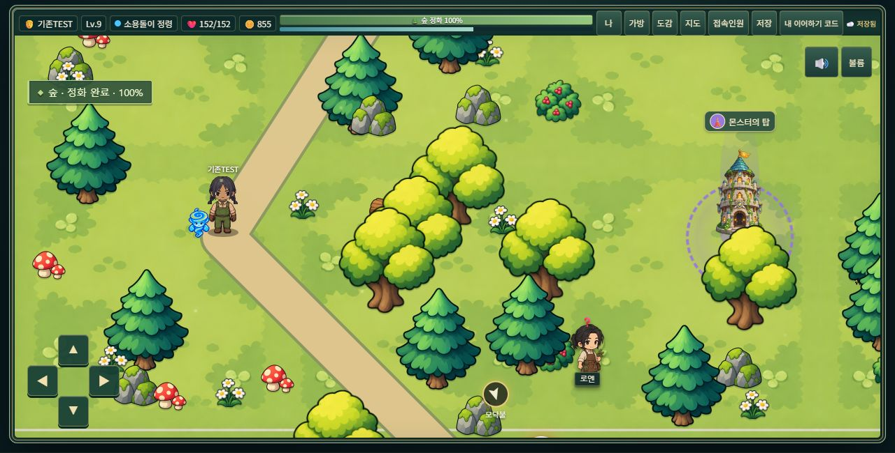

# 학생 클라우드 세이브 2단계

검증일: 2026-10-21. 프런트엔드 BUILD_VERSION: **2026.10.21.2**.
실제 Supabase 프로젝트: `akpkwypxupghvcghywab` / eco-chronicle.
기존 학생 데이터, `S.code`, `SAVE_VERSION = 9`, `echo:` 슬롯 형식은 유지했다.
commit / push / GitHub Pages 배포는 하지 않았다.

## 1. 새 학생

기존 이름 → 외형 → 정령 → 조작 안내를 그대로 거친다. 기존 로컬 최초 저장을 먼저 하고,
월드 입장 시 코드 발급을 비동기로 시작한다. 성공하면 기존 모달에 `내 이어하기 코드`,
`코드 복사`, `확인했어요`를 표시한다. 실패해도 게임은 계속하며 같은 발급 요청 ID를 유지한다.
서버의 성공 응답이 오기 전까지 확정된 cloudCode는 없다.

## 2. 기존 학생 승격

기존 EC 번호/이 기기 목록으로 이어한 뒤, 미연결 학생에게 코드 만들기를 한 번 안내한다.
학생이 선택하면 현재 상태를 기존 migrate()와 CloudSave.snapshot()으로 검증하여 보낸다.
승격 요청 자체는 기존 `echo:<EC번호>`를 쓰거나 지우지 않는다. 실패/timeout에도 원본을 유지한다.
안내를 닫았더라도 HUD의 `내 이어하기 코드`에서 다시 만들 수 있다.

## 3. 다른 기기

시작 화면의 `저장 코드로 이어하기`에서 대소문자와 하이픈 유무를 정상화한다.
서버 데이터 검증 → 기존 migrate() → 기존 게임 재개 함수를 사용한다.
기존 로컬 저장과 클라우드 저장의 초기화/진입 경로를 별도로 만들지 않았다.

## 4. 두 코드의 분리

`S.code`는 기존 EC 네 자리 번호다. 다른 기기에서도 이 값을 교체하지 않는다.
cloudCode는 연결 메타데이터에만 있으며 학생 진행 JSON, URL, hash, DOM data 속성,
Presence/이동 Broadcast, 접속인원, 일반 HUD와 로그에 포함하지 않는다.
학생이 여는 코드 모달/코드 입력창에서만 전체 값을 표시한다. 테스트 화면 캡처에도 전체 코드는 없다.

## 5. 연결 / 세션

`echo:__cloud_links`는 임의 UUID를 키로 한 연결 사전이다. 각 항목은
`id, localCode, kind(local/cache), cloudCode, revision, lastSyncedAt, pendingSync, createRequestId, offered`를 가진다.
미확정 생성 요청에는 cloudCode가 null이고 요청 ID만 저장된다.
`echo:__cloud_last`에는 비밀 코드 대신 로컬 연결 UUID만 저장한다.

`CloudSync`가 저장 순서/재시도/충돌을 담당하고, 읽기용 `CloudSession`에는
active/code/revision/pending/status가 보인다. 게임 규칙은 이 계층에 없다.
세션을 전환한 뒤 도착하는 이전 응답은 세대 번호로 무시한다.

## 6. 로컬 캐시 / 슬롯 충돌 방지

`echo:cloud:<로컬 UUID>` 하나에 최신 상태와 저장 시각/revision/pending 여부를 보관한다.
같은 캐시가 최신 미전송 snapshot 역할도 한다. 변경 이력 queue를 쌓지 않는다.
서버에서 불러온 학생의 저장은 이 영역으로만 향하며, 우연히 같은 S.code의 기존 학생 슬롯을 건드리지 않는다.
원래 이 기기에서 만든 학생은 기존 슬롯 저장을 그대로 유지한다.
기존 `echo:__index`, `echo:__last`의 의미와 형식도 그대로다.

가져온 상태 객체의 캐시 소유권은 WeakMap으로 유지한다. 세션 중지 후 탭 종료 저장도
일반 EC 슬롯으로 잘못 빠지지 않는다. 서버에서 온 내부 코드가 연결의 localCode와 다르면
적용을 거부하여 다른 학생 슬롯에 쓰는 일을 막는다.

## 7. 자동 저장 / debounce

기존 Save.save()를 한 곳에서 감싼다. 로컬 저장이 먼저 끝나고 나서 비동기 예약만 한다.
전투/미니게임 결과, 재화/장비, 지역 이동, 농장, 학습, 탑 등 기존 autosave 호출 위치는 바꾸지 않았다.
기본 debounce는 **1,500ms**. 한 번에 서버 쓰기 요청 하나만 실행한다.
저장 중 변경이 생기면 최신 상태를 남기고 완료 후 한 번 더 저장한다.
상태 비교는 객체 키 순서와 scene/modal을 제외한 정규화된 학생 진행 기준이다.
변화 없는 Save.save()는 새로운 서버 저장을 만들지 않는다.

저장/학생 UI 스크립트는 Realtime CDN보다 먼저 일반 스크립트로 로드한다.
CDN 지연이 로컬 백업, 입력 UI, 게임을 막지 않는다. 공개 연결 설정은 요청 시 읽으며
설정이 아직 없으면 로컬 진행을 유지한 채 코드 발급/동기화를 재시도한다.

## 8. pending / 재시도

최신 로컬 상태 1개와 pendingSync를 유지한다. 실패 후 서버 revision을 예상 증가시키지 않는다.
재시도는 다음 저장, 게임 재개, online 이벤트 및 단일 backoff 타이머가 담당한다.
실패 backoff는 5 → 10 → 20 → 40 → 60초 상한이며 offline/conflict에는 반복 요청하지 않는다.
오래된 응답과 다중 writer를 방어한다. 영구적인 데이터 불일치는 자동 덮어쓰기를 중단한다.

## 9. 오프라인

캐시/기존 로컬 기록이 있으면 서버 연결 실패 시 해당 기록으로 재개하고 짧게 안내한다.
캐시가 없는 새 기기는 연결 실패를 안내하며 새 학생을 임의로 생성하지 않는다.
읽기 오류/미래 버전/없는 코드 등은 네트워크 실패로 오인하여 캐시를 자동 적용하지 않는다.
온라인의 기존 연결 학생은 서버 최신 revision을 먼저 확인한다.
미전송 로컬이 있고 서버도 달라졌으면 충돌 선택을 거친다.

pagehide와 기존 beforeunload/visibilitychange 경로는 즉시 로컬 백업을 남긴다.
종료 시 네트워크 저장의 보장이나 keepalive에 의존하지 않는다.

## 10. revision 충돌

409이면 먼저 최신 서버 데이터를 읽는다. 현재 pending과 동일하면 응답 유실로 보고
서버 revision을 수용하고 pending을 해제한다. 불필요한 선택 화면을 띄우지 않는다.
내용이 다르면 `다른 기기에서도 게임 기록이 저장되었어요`와 양쪽 저장 시각/레벨/지역/탑 요약을 보여 준다.

서버 선택: 최신 로컬 변경을 디스크 백업한 뒤 서버 상태를 기존 migrate/재개 경로로 적용한다.
기기 선택: 최신 서버 revision을 다시 읽고 서버 상태를 백업한 뒤, 명시적으로 선택한 로컬 상태를 CAS 저장한다.
동시에 또 다른 쓰기가 끼어들면 자동 덮어쓰기 반복 없이 다시 선택하도록 유지한다.
`echo:cloud-conflict:<UUID>`는 학생당 최근 **3개**만 남긴다.
안전 백업을 디스크에 쓸 수 없으면 기록 교체를 거부한다.

## 11. create idempotency

브라우저 crypto.randomUUID() 또는 동등한 crypto.getRandomValues() UUID v4를 사용한다.
서버 요청 전에 요청 ID를 장치 메타데이터에 먼저 확정한다. 이 쓰기가 실패하면 생성 요청을 보내지 않는다.
재시도/새로고침은 같은 ID를 사용한다.

추가 nullable UNIQUE UUID 열 `create_request_id`와 서비스 전용
`student_save_create_once(text,jsonb,integer,uuid)` RPC가 같은 요청의 동시 재시도를 직렬화한다.
기존 요청이면 현재의 같은 코드/행을 반환하며 저장 본문을 다시 쓰지 않는다.
기존 행과 1단계의 ID 없는 create 호출/RPC도 그대로 동작한다.
코드 생성 공간은 기존 31문자 × 8자리(31^8)를 유지한다.

## 12–17. 실제 브라우저 / Supabase 검증

실제 IAB 브라우저의 두 탭을 서로 다른 origin `127.0.0.1:54431`, `127.0.0.1:54432`에서 실행했다.
이들은 localStorage가 분리된 실제 브라우저 문서다. VM 테스트를 브라우저 테스트로 세지 않았다.
Chrome 일반/시크릿 창 자체는 아니다. 첫 진입의 슬롯/캐시 개수는 모두 0이었다.

브라우저 요청은 TEST용 로컬 프록시가 본문을 그대로 실제 Supabase Edge Function에 전달했다.
제품 프런트에는 이 프록시/테스트 버튼/장애 주입 코드가 없다. GitHub Pages origin의 실제 CORS preflight도 별도 통과했다.

| 실제 시나리오 | 결과 |
|---|---|
| A 기존 캐릭터 생성 전 과정 → 코드 발급 | 신규TEST, 내부 EC 번호 유지, 서버 revision 1 |
| A 재화 60 → 70 자동 저장 → 빈 B 코드 입력 | 같은 학생/70, revision 2, B 일반 슬롯 0/캐시 1 |
| 새로고침 → 이 기기에서 이어하기 | A 일반 슬롯/B 캐시 모두 같은 서버 최신 기록으로 재개 |
| B 저장 통신 offline → 70 → 80 → online | local/pending 유지, 자동 서버 revision 3 |
| A의 다른 90 진행, 이전 revision 2로 저장 | 자동 덮어쓰기 없음, 실제 충돌 UI |
| A 서버 기록 선택 | 80으로 재개, 기기의 90은 충돌 백업 |
| A 90 저장 → B 100으로 다른 진행 → 기기 기록 선택 | 최신 revision 재확인 후 100/revision 5, 서버 90 백업 |
| B 저장 성공 후 응답만 유실, 110 진행 | 재시도 시 load/동일성 확인, revision 6 수용, 충돌 UI 없음 |
| 기존 EC1234 fixture → 기존 이어하기 → 승격 | Lv9, EXP1423, 845골드, 장비/정화/농장/생태기술/학습/탑 유지 |
| 승격 create 성공 후 응답만 유실 → 같은 ID 재시도 | 기존TEST 행 정확히 1개, 같은 코드/revision 1 |
| 승격 코드로 B 이어하기 | 키 순서 무관 비교: 위 모든 진행 항목 일치, 탑 18층/462초 포함 |
| B 오프라인 캐시 재개 → 가방 → 추가 진행 → online | 오류 없이 재개/가방, 855골드/revision 2 동기화 |
| B 지도 → 숲 재방문 | 기존 강 진행 보존, 기존 숲 100% 복원, 자동 revision 3 |
| 코드 다시 보기 / 복사 | 코드 모달 정상, 실제 `코드를 복사했어요.` 확인 |
| 1280×800 가로 화면 | HUD/코드 메뉴가 화면 안에 들어옴, 로컬 방향키 이동 DOM 위치 변화 확인 |

실제 DB 집계에서도 신규TEST 1행 + 기존TEST 1행, 서로 다른 요청 ID 2개였다.
위 기록은 인공 TEST 학생만 사용했다. 실제 학생을 불러오거나 수정하지 않았다.
검증 뒤 TEST 2행은 deleted_at으로 격리했고, load 결과가 NOT_FOUND인 것도 확인했다.
원본 JSON은 남겼으며 영구 삭제하지 않았다.



## 18. 보안 회귀

실제 anon SELECT/INSERT/UPDATE/DELETE 및 기존 RPC 직접 실행: 모두 401/차단.
신규 RPC는 anon/authenticated EXECUTE 권한 없음, RLS와 FORCE RLS 모두 true.
서비스 비밀 키/DB 비밀번호를 브라우저나 저장소에 추가하지 않았다.
학생 API는 여전히 create/load/save만 제공한다. list/delete/restore/admin 기능은 없다.
권한/키 literal/로그 마스킹/입력 및 크기 검증 자동 테스트 통과.
Presence/Broadcast 파일은 수정하지 않았고 cloudCode는 공유 payload에 넣지 않았다.

Security Advisor의 student_saves `RLS Enabled No Policy`는 의도한 완전 차단 설계다.
기존 `public.rls_auto_enable()`의 anon/authenticated SECURITY DEFINER 경고는 이 변경 전부터 있었으며
이번 저장 기능에서 사용하거나 변경하지 않았다.
[기존 함수 경고 조치 안내](https://supabase.com/docs/guides/database/database-linter?lint=0028_anon_security_definer_function_executable).

## 19. 기존 게임 / 자동 테스트

클라우드 세이브/동기화/과거 저장 호환성/캐시 버전/소리: **80개 테스트 통과**.
21개 동기화 테스트에는 실제 PostgreSQL SQL, 동일 Edge handler, HTTP 클라이언트,
동시 create/CAS, retry, offline reload, 응답 유실, 양쪽 충돌 선택, 3개 백업 상한,
용량 오류와 가져온 슬롯 충돌/세션 중지 후 저장/잘못된 서버 내부 코드/미래 버전 덮어쓰기 방어가 포함된다.

추가 8개 회귀 suite: 장비·생태기술, 순차 진행/40회 미니게임 선택,
상위 중간보스 8종, 동물 돌봄, 플로킹, movement, 35명 Presence, 접속인원/탑 기록 통과.
정화 퍼즐 focused 검증: 20개 랜덤 보드, 1,200개 인접 swap, 실제 입력 126회,
false positive/negative 0. 게임 규칙/보상/경험치/저장 스키마는 바꾸지 않았다.

실제 게임 window error/unhandledrejection 수집: 최종 브라우저 실행에서 0개.
브라우저 도구 로그에는 MutationObserver 오류가 나타났으나, 앱 JavaScript가 전혀 없는
`tests/fixtures/cloud-browser-control.html`에서도 동일하게 재현했다. 이를 게임 오류 0개라는
주장에 숨기지 않고 별도 도구 환경 오류로 기록한다. 의도적인 통신 실패/409 경고는 마스킹된 진단이다.

## 20. 이번 단계 변경 파일

- 추가: `js/cloud-sync.js`, `js/cloud-ui.js`, `css/cloud-save.css`
- 수정: `js/cloud-save.js`, `js/game.js`(공통 재개 함수와 시작 화면 문구만), `index.html`
- 서버: `supabase/functions/student-save/handler.mjs`, 아래 추가 migration
- 배포 버전 도구 결과: `js/build-version.js`, `css/style.css`(기존 캠프파이어 query만), `index.html`
- 테스트: `tests/cloud-sync.test.mjs`, `tests/helpers/cloud-save-runtime.mjs`, `tests/cache-version.test.cjs`,
  `tests/serve-cloud-sync.mjs`, `tests/cloud-sync.html`, `tests/cloud-sync-browser.js`,
  `tests/fixtures/cloud-browser-control.html`
- 보고: 이 문서, `docs/images/cloud-save-stage-2-tablet.jpg`

1단계의 미커밋 파일은 보존했다. 전투/다른 미니게임/멀티플레이/장비/농장 규칙의 제품 코드는 변경하지 않았다.

## 21–23. 실제 서버와 배포 버전

- 실제 적용 migration: **20261021101419_student_saves_idempotent_create.sql**.
- student_saves에 nullable UNIQUE UUID 열 하나와 서비스 전용 SECURITY INVOKER 함수 하나를 추가.
  DROP/테이블 재생성/기존 데이터 재작성 없음. 기존 migration `20261021090016`도 유지.
- 실제 Edge Function: **student-save v2, ACTIVE**. 기존 v1의 create/load/save와 보안 검사를 유지하면서
  createRequestId가 있는 create만 신규 RPC로 보낸다. 함수 ID/endpoint는 그대로다.
- `tools/update-build-version.cjs`로 **2026.10.21.2** 적용. 재실행 시 변경 0.
- 프런트엔드 commit/push/Pages 배포는 하지 않았다.

## 24. 남은 제한 / 운영 강화

1. Galaxy Tab S5e 실기기/학교 Wi-Fi/Chrome 시크릿 직접 검증은 하지 않았다.
   실제 분리 origin 브라우저 2개와 1280×800 viewport 검증이다.
2. 이번 브라우저 검증은 Cloud API에 실제 Supabase를 사용했지만 Realtime CDN을 제외해 저장 장애를 분리했다.
   Presence/Broadcast 유지 여부는 기존 35명/이동/탑 정보 회귀 suite로 검증했다. 실시간 35명+Cloud 동시 실기기 검증은 아니다.
3. Offline/응답 유실은 브라우저 테스트 전용 transport에서 재현했다. OS 전체 Wi-Fi를 끄지는 않았다.
4. 서버 저장 성공 후 응답을 잃고 그 사이 로컬 상태가 더 바뀐 경우, 서버와 현재 pending이 다르면
   보수적으로 충돌 선택을 요구할 수 있다. 임의 데이터 병합/자동 덮어쓰기는 하지 않는다.
5. 로컬 저장 공간/쓰기 권한이 부족하면 기존 슬롯을 삭제하지 않고 메모리 폴백과 경고를 사용한다.
   안전한 발급 ID/충돌 백업을 저장할 수 없으면 해당 작업을 중단한다. 용량 부족+오프라인에서
   새 진행의 탭 종료 후 보존은 보장할 수 없으므로 저장 공간 경고를 표시한다.
6. 페이지 종료 시 서버 저장은 보장되지 않는다. 평상시 1.5초 저장과 장치 pending이 복구 수단이다.
7. 분산 서버 rate limiting은 아직 없다. Edge isolate 안의 메모리 카운터나 브라우저 debounce를
   보안 제한이라고 부르지 않는다. 공식 예시는 외부 Redis를 이용한다.
   IP 영구 기록/새 외부 서비스는 요청 없이 추가하지 않았다. 수업 공개 운영 강화 항목으로
   외부/플랫폼 rate limit 및 필요시 서버 측 남용 방지 정책을 별도 검토해야 한다.
   [Supabase 공식 rate limiting 안내](https://supabase.com/docs/guides/functions/examples/rate-limiting).

### 재현

```text
node --test tests/cloud-sync.test.mjs tests/cloud-save.test.mjs tests/legacy-save.test.cjs tests/cache-version.test.cjs tests/sound-settings.test.cjs
node tests/serve-cloud-sync.mjs           # 로컬 PostgreSQL로 UI 검증
node tests/serve-cloud-sync.mjs --live    # 실제 Supabase, 인공 TEST 학생만 사용
```

80개 검사에 필요한 선택적 PostgreSQL WASM 테스트 런타임 설치 방법은 1단계 문서를 따른다.
테스트/개발 도구는 게임 실행이나 GitHub Pages 빌드에 필요하지 않다.
