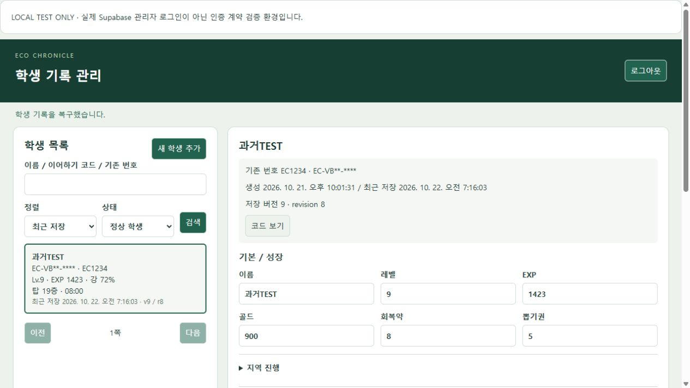

# 학생 클라우드 세이브 3단계 · 관리자 관리 시스템

검증일: 2026-10-22 (한국 시간). 프로젝트: `akpkwypxupghvcghywab`.

**코드/DB/Function 준비 완료. 관리자 계정 등록 필요.**

실제 프로젝트의 Auth 사용자와 관리자 allowlist는 모두 0명이다. 실제 관리자 계정이나 비밀번호를 임의 생성하지 않았다. 따라서 실제 Supabase 관리자 로그인 및 실제 관리자 JWT를 이용한 정상 CRUD는 아직 검증하지 않았다. 아래의 정상 동작 검증은 격리된 TEST 환경에서 수행했다. 실제 학생 row는 수정·삭제·코드 재발급하지 않았다.

## 1. 관리자 인증 방식

별도 `admin.html`에서 Supabase JS 2.117.0 CDN의 `signInWithPassword()`를 사용한다. 서버는 사용자 JWT를 요구하며 Auth `/auth/v1/user`로 매번 사용자 유효성을 확인하고, 활성 `app_admins`를 조회한다. 이메일 문자열, 사용자 metadata, 학생 코드로 권한을 부여하지 않는다. 브라우저에는 기존 공개 publishable key만 있다.

SDK 표준 자동 세션 갱신을 사용하고 관리자 세션은 `sessionStorage`의 `eco:admin:session`에 저장한다. 비밀번호 입력은 로그인 요청 후 비운다. 로그아웃/401/403 시 목록·상세·편집본·코드 팝업·이전 요청 상태를 제거한다. 뒤늦게 도착한 응답도 화면을 복구하지 못하도록 요청 세대를 확인한다.

## 2. app_admins 구조

`user_id uuid PK → auth.users.id`, `created_at timestamptz`, `display_name text nullable`, `disabled_at timestamptz nullable`. 활성은 `disabled_at IS NULL`이다. RLS + FORCE RLS, 브라우저 SELECT/INSERT/UPDATE/DELETE 및 RPC 실행 권한 없음. 서버 역할은 allowlist를 읽기만 한다. 관리자 계정 생성/권한 부여 UI는 제공하지 않는다.

## 3. 관리자 Edge Function 구조

`student-admin`만 `list/get/update/create/softDelete/restore/rotateCode/export`를 제공한다. `verify_jwt=true`에 더해 함수 내부에서 Auth 사용자와 allowlist를 재확인한다. 기존 `student-save` HTTP API에 관리자 action을 추가하지 않았다.

서버 전용 `student_admin_allowed/list/get/mutate` RPC는 SECURITY INVOKER이며 service-role 실행만 허용한다. 서버 키는 Edge 환경변수로만 읽는다. CORS는 기존 `CLOUD_SAVE_ALLOWED_ORIGINS`를 재사용한다. 입력 본문 256 KiB, 학생 JSON 128 KiB, 목록 최대 50개(기본 UI 25개), 응답 no-store, 인증/DB 요청 시간 제한을 적용했다. SQL·JWT·코드·세이브 전체를 오류 로그에 출력하지 않는다.

## 4. 목록 / 검색 / 상세

목록은 서버가 생성한 요약만 반환한다. 이름, 마스킹된 코드, 기존 EC 번호, 레벨/EXP, 지역/정화율, 탑 층/시간, 버전/revision, 저장일, 삭제 상태를 표시한다. 상세 선택 시에만 해당 학생 JSON을 가져온다. 전체 코드는 명시적인 코드 보기/재발급/생성/백업에서만 제공한다.

이름·기존 번호 부분 검색, cloudCode 대소문자/하이픈 정규화 검색, 최근 저장/이름/레벨/탑/생성일 정렬, 정상/삭제/전체 필터, 페이지 이동을 제공한다. 검색 문자열을 SQL로 조합하지 않는다.

## 5. 편집 가능한 필드

이름, `lv/exp/gold/potions/tickets`, 현재 `themeId/gauge`, `cleared` 및 실제 지역 `progress`와 학습/퀴즈/생각 넓히기/전투 완료 플래그, `owned/gear`, 농장 화단/축사, `ecoTechUnlocked`, `tower.best/bestTime`을 폼으로 편집한다. 학습 상세·생태기술 조사 상세·탑 과거 이력·전체 JSON은 읽기 전용이다. 내부 `S.code`는 변경하지 않는다.

등록 장비 ID는 실제 카탈로그에서 선택한다. 미등록 legacy ID/추가 metadata는 그대로 두면 보존하고, 새로운 임의 ID/게임 규칙 루트 삽입은 거부한다. 지역 순차 진행과 맞지 않는 편집에는 경고를 표시한다. 최고 층과 연결된 시간은 함께 검증한다. 레벨 범위는 실제 MAX_LV=15, 시간 원본은 초 단위를 유지한다.

관리자 검증 프레임은 실제 `game.js`의 `migrate()`를 실행한다. 조회만으로 서버 저장을 재작성하지 않는다. 구버전 수정 시에만 v9로 정리하고 미래 버전은 읽기/백업만 허용한다. 학생 전투/몬스터/EXP 표/보상/미니게임 규칙을 편집하지 않는다.

## 6. revision 기반 편집

update/delete/restore/rotate 모두 `expectedRevision`을 요구한다. 동일 RPC에서 row lock과 CAS를 확인하고 성공 시 revision +1, updated_at 갱신. 불일치 시 `ADMIN_REVISION_CONFLICT`와 최신 기록 재조회 안내를 반환한다. 관리자와 학생 모두 자동 덮어쓰지 않는다.

## 7. 관리자 backup

`student_save_admin_backups`: id, student_save_id, 원본 revision/cloud_code/save_data/save_version, reason, admin_user_id, created_at. update/soft delete/restore/rotate 직전에 백업한다. 백업 생성·수정·보관 개수 정리·audit는 한 트랜잭션이다. 백업 실패 시 원본 수정도 롤백된다. 학생당 최근 **10개**만 보관하며 삭제 권한은 이 백업 정리에만 사용한다. 학생 본 저장 DELETE 권한은 늘리지 않았다.

## 8. audit log

`student_admin_audit`: id, admin_user_id, student_save_id, action, created_at, metadata. CREATE/UPDATE/SOFT_DELETE/RESTORE/ROTATE_CODE/EXPORT 및 명시적 VIEW_CODE를 기록한다. metadata는 서버가 계산한 변경 루트 필드명만 담고 전체 JSON·비밀번호·인증 토큰·새 코드를 담지 않는다. 최대 4 KiB다.

## 9. 새 학생 추가

기존 `newState()` 본문을 값 변경 없이 `js/student-state.js`로 공유했다. 게임의 `newState()`와 관리자 서버 생성이 동일한 helper를 사용한다. 이름과 정령만 받고 v9/revision 1로 생성한다. 학생과 동일한 crypto 기반 코드 생성 함수/문자집합을 재사용한다. 생성 요청 UUID와 DB lock/unique를 이용해 응답 유실 후 재시도가 새 학생을 중복 생성하지 않게 했다.

## 10. soft delete

확인창 후 deleted_at을 설정하고 revision/time을 갱신한다. 삭제 전 backup과 audit를 남긴다. 학생 load/save는 NOT_FOUND가 된다. 영구 삭제 API/UI는 없다.

## 11. restore

삭제 필터에서 선택해 CAS 복구한다. deleted_at=null, revision +1 및 backup/audit. 기존 code와 save_data가 유지되어 같은 코드로 다시 load 가능하다.

## 12. 코드 재발급

별도 기록 관리 영역과 명시적 확인을 거친다. 같은 row/id/save_data/created_at을 유지하고 code만 교체하며, 요구된 revision +1/updated_at/backup/audit를 함께 처리한다. UNIQUE 충돌은 전체 작업을 롤백한 뒤 새 코드로 최대 8회 재시도한다.

보안상 필요한 최소 보완으로 기존 `student_save_create_once` RPC에 **회전 이력이 있으면 예전 생성 요청 UUID 재사용을 거부하는 검사**를 추가했다. 이전 발급 확인용 UUID로 새 비밀 코드를 다시 알아내거나 학생을 중복 생성할 수 없게 한다. 정상 create/load/save HTTP 형식 및 회전하지 않은 생성 재시도 동작은 유지한다. 기존 `student-save` 함수는 재배포하지 않았다.

기존 기기가 옛 코드로 저장해 NOT_FOUND를 받으면 재시도를 멈추고 새 코드 입력 안내를 제공한다. 로컬 진행/미전송 snapshot은 보존한다. 새 코드는 직접 입력해야 하며 옛 코드에서 유추하지 않는다. 새 서버 기록을 여는 동작은 옛 pending을 자동 병합/덮어쓰지 않는다. 기존 pending은 옛 기기 슬롯/캐시에 남아 교사와 비교 복구할 수 있다.

## 13. export

active 관리자 전용 export 결과를 JSON 다운로드한다. code/saveVersion/revision/updatedAt/saveData만 포함하며 서버 키나 관리자 토큰은 포함하지 않는다. 파일명에는 비밀 코드를 넣지 않는다. EXPORT audit 외에 학생 revision/updated_at은 변경하지 않는다. 파일에는 학생 접근 코드가 포함되므로 학생 본인과 교사만 보관한다.

## 14. 관리자 UI 파일 / 수정 범위

신규 제품 파일: `admin.html`, `admin-state.html`, `css/admin.css`, `js/admin-config.js`, `js/admin-state-boot.js`, `js/student-admin-client.js`, `js/student-admin.js`, `js/student-state.js`, `supabase/functions/student-admin/{index.ts,handler.mjs,validation.mjs,catalog.mjs}`.

연결 수정: `index.html`(공통 초기 상태 helper 로딩 1개), `js/game.js`(기존 초기값 공유/검증용 비렌더링 부팅), `js/cloud-sync.js`/`js/cloud-ui.js`(코드 무효화 안내/미전송 보존), `supabase/config.toml`, build 관리 도구와 버전 참조.

검증/유지보수: `tests/student-admin.test.mjs`, `tests/student-admin-client.test.mjs`, `tests/helpers/admin-runtime.mjs`, `tests/serve-student-admin.mjs`, `tools/update-admin-catalog.mjs`, `tools/cloud-admin-security-smoke.mjs`. 기존 게임 테스트 harness는 공통 helper를 먼저 읽도록 연결했고 생태기술 harness에 viewport DOM stub을 보완했다. 멀티플레이/사운드/게임 규칙 파일은 수정하지 않았다. 이전 1·2단계의 미커밋 변경은 보존했다.

## 15. 신규 migration 파일

`supabase/migrations/20261021221301_student_admin_management.sql`.

원격에 적용된 migration version과 파일명이 일치한다. 기존 student_saves를 DROP/재생성하거나 기존 학생 row를 재작성하지 않았다.

## 16. 실제 Supabase 적용

적용 완료. 신규 세 테이블 모두 RLS/FORCE RLS 활성, anon/authenticated 모든 직접 CRUD 권한 없음. 신규 네 RPC 및 기존 생성 RPC의 browser EXECUTE 없음. student_saves의 service-role DELETE도 계속 false. 적용 후 app_admins=0, Auth users=0, 관리자 audit=0을 확인했다. 실제 학생을 대상으로 관리자 작업을 실행하지 않았다.

## 17. Edge Function 배포

`student-admin` **v1 ACTIVE / verify_jwt=true** 확인. 기존 `student-save`는 **v2 ACTIVE / verify_jwt=false(기존 학생 코드 인증)** 그대로다. 서비스 함수 배포만 수행했으며 commit/push/GitHub Pages 배포는 수행하지 않았다.

## 18. 사용자가 직접 해야 할 관리자 등록

현재는 관리자로 허용된 계정이 없다. 다음을 사용자가 직접 수행해야 한다.

1. [프로젝트 Authentication → Users](https://supabase.com/dashboard/project/akpkwypxupghvcghywab/auth/users)를 연다.
2. `Add user`의 `Create new user`로 실제 교사 이메일/비밀번호를 본인이 입력한다. 본인 소유의 이메일을 확인한 계정으로 준비한다. 비밀번호를 채팅이나 저장소에 남기지 않는다. 기존 계정이 생겼다면 새로 만들지 않고 해당 계정의 UUID를 사용한다. Users 메뉴 위치는 [Supabase 공식 안내](https://supabase.com/docs/guides/auth/users)를 참고한다.
3. Users에서 실제 사용자 UUID를 복사한다. 아래 `<실제_AUTH_USER_UUID>`를 그 값으로 바꿔 프로젝트 SQL Editor에서 실행한다. 이 SQL은 **지정한 사용자에게 학생 관리 권한을 부여**한다.

```sql
insert into public.app_admins(user_id, display_name)
values ('<실제_AUTH_USER_UUID>'::uuid, '관리자')
on conflict (user_id) do update
set disabled_at = null, display_name = excluded.display_name;
```

권한 중지는 같은 UUID에 다음을 실행한다. 이미 로그인된 JWT가 있어도 이후 관리자 요청이 거부된다.

```sql
update public.app_admins
set disabled_at = now()
where user_id = '<실제_AUTH_USER_UUID>'::uuid;
```

4. 별도 frontend 공개는 이번 요청에서 하지 않았다. 사용자가 이후 사이트를 게시하면 동일 사이트의 `admin.html`을 직접 연다. 학생 게임에는 링크가 없다. 로컬에서 실제 서버를 연결해 검증하려면 기존 `CLOUD_SAVE_ALLOWED_ORIGINS`에 승인된 개발 origin이 있어야 한다. 이번에는 그 설정을 넓히지 않았다.
5. 이 계정으로 실제 서버 로그인 → TEST 학생 추가/CRUD/충돌/재발급/복구/export를 확인하고 TEST 학생을 soft delete한다. 이 단계는 아직 미실행이다.

## 19. TEST 학생 CRUD 결과

격리 PostgreSQL(PGlite)에 실제 migration과 제품 handler를 실행했다. Auth 계약 fixture는 임시 ES256 서명 JWT의 서명/issuer/만료/사용자를 검증한다. 실제 Auth 서버 로그인 성공을 대신하는 증거로 취급하지 않는다. 제품에는 테스트 우회 경로가 없다.

브라우저에서는 실제 Supabase SDK + 이 격리 환경을 연결해 로그인, 요약 목록, 코드 정규화 검색, 상세, 골드 845→900, 탑 18층/07:42→19층/08:00, 버전 8→9 저장, 신규 학생/물정령 선택, 삭제/복구/재발급/코드 보기/JSON 다운로드/로그아웃을 확인했다. 테스트 학생은 끝에 모두 soft delete했다. 테스트 서버 DB는 메모리에만 있었고 종료했다. 실서비스 TEST 계정/학생은 추가하지 않았다.

1280×720 실제 콘텐츠 viewport에서 가로 넘침 없음(document width 1265), 목록/상세 분리와 폼 사용을 확인했다. 하드웨어 Galaxy Tab S5e 실기기 테스트는 하지 않았다.



## 20. 학생 vs 관리자 revision conflict

양방향 통과. 학생이 먼저 저장하면 오래된 관리자 수정은 409. 관리자가 먼저 수정하면 실제 CloudSync가 REVISION_CONFLICT를 감지하고 선택 경로로 전환한다. 어느 쪽도 자동 overwrite하지 않는다. 오래된 delete/restore/rotate도 실패하며 추가 backup/audit가 생기지 않는다.

## 21. 재발급 테스트

옛 코드 load/save NOT_FOUND, 새 코드 load 성공, 동일 id/동일 진행, revision 증가, backup/audit 확인. 옛 createRequestId 재시도 거부 및 row 중복 없음. UNIQUE 충돌 시 원본/backup/audit 롤백 확인. 실제 CloudSync에서 옛 코드 저장 중단·로컬 pending 유지·새 코드 별도 재연결도 통과했다.

## 22. 삭제 / 복구 테스트

삭제 후 학생 load/save 거부 및 삭제 목록 존재, 복구 후 같은 code/진행으로 load 성공. CAS와 revision 증가 통과. 서버 자동 백업 최근 10개 유지 및 백업 실패 시 수정 취소를 검증했다.

## 23. 관리자 보안 테스트

격리 환경: active 관리자 허용, 일반 Auth 사용자/disabled 관리자/만료 JWT/가짜 JWT/학생 코드/공개 키 단독 거부. 같은 JWT로 allowlist 비활성화 후 재요청도 거부. 잘못된 타입·음수·unsafe integer·미래 버전·추가 규칙·미등록 장비·과대 payload·잘못된 revision은 DB 손상 없이 거부했다. 코드/토큰/세이브 전체가 오류 로그에 없음을 검사했다.

실제 서버: 무JWT/공개 키 단독/가짜 JWT/학생 코드 요청 **모두 401**. 세 관리 테이블의 직접 읽기와 admin RPC 직접 호출도 **모두 401**. 기존 학생 테이블 직접 CRUD/RPC 차단도 재검증했다. 실제 일반/active/disabled Auth 계정 로그인은 계정 부재로 미검증이며 위 양성/권한해제 테스트는 격리 환경 결과다. 프런트/저장소에 실제 service key·DB 비밀번호·관리자 비밀번호를 추가하지 않았다.

## 24. 학생 기능 회귀 / 오류

통합 자동 검사 **115/115 통과**. 기존 새 학생/승격/코드 이어하기/local 저장/자동 저장/offline/pending/conflict/구버전 이주, 35명 Presence/remote 이동/탑 기록 공유, 사운드, 장비/생태기술/지역 진행, 탑 전투, 동물 돌봄/플로킹, 정화 퍼즐을 포함한다. 퍼즐 검사는 5,000개 stable random board / 300,000 adjacent swap / 실제 입력 실행 34,088건에서 false positive/negative 0이었다. 전체를 실제 교실 기기에서 재플레이했다는 뜻은 아니다.

관리자 프레임에서 불필요한 `equipment-ui.js`가 SPRITES 없이 실행되던 오류를 발견해 그 프레임 로딩에서 제거했다. 새 세션에 해당 오류 없음. 자동화 브라우저는 앱 소스 URL이 없는 MutationObserver 오류 1개를 기록했으며, JS가 전혀 없는 iframe 대조 페이지에서도 동일 오류가 재현되었다. 이를 제품 오류 0이라는 주장에 섞지 않고 별도로 남긴다. 제품 스크립트 출처 오류는 최종 확인에서 추가 발견되지 않았다.

## 25. BUILD_VERSION

기존 도구 `node tools/update-build-version.cjs 2026.10.21.3`로 **2026.10.21.3**을 적용했다. 저장 버전은 **9** 그대로이며 기존 echo: 키/학생 데이터 구조는 변경하지 않았다. 관리자 entry/검증 프레임도 같은 도구로 참조 버전을 관리한다.

## 26. 제한사항 / 후속 검증

실제 관리자 계정 등록/allowlist 및 정상 로그인 검증이 남아 있다. GitHub Pages 미배포 상태다. Auth 초대/비밀번호 재설정 UI·MFA·다중 export·백업 복원 UI는 이번 범위에 넣지 않았다. 코드 재발급 후 옛 pending과 새 서버 기록을 자동 합치지 않는다. 관리자 변경량이 많을 때 분산 rate limiting은 별도 정책이 필요하며 현재 크기/인증/동시성 제한을 분산 rate limit이라고 부르지 않는다.

Supabase 보안 점검의 새 테이블 `RLS Enabled No Policy` INFO는 브라우저 접근을 전면 차단하기 위한 의도된 상태다. [점검 항목 설명](https://supabase.com/docs/guides/database/database-linter?lint=0008_rls_enabled_no_policy).

기존 `public.rls_auto_enable()`의 SECURITY DEFINER 실행 권한 경고(anon/authenticated 각 1건)는 이전부터 있던 프로젝트 항목으로 이번 관리자 RPC와 다르다. 무관한 함수 권한을 임의 변경하지 않았다. 필요시 [anon 경고](https://supabase.com/docs/guides/database/database-linter?lint=0028_anon_security_definer_function_executable), [authenticated 경고](https://supabase.com/docs/guides/database/database-linter?lint=0029_authenticated_security_definer_function_executable)의 절차로 별도 검토한다.

## 검증 재현

```text
node --test tests/student-admin.test.mjs tests/student-admin-client.test.mjs tests/cloud-sync.test.mjs tests/cloud-save.test.mjs tests/cache-version.test.cjs tests/legacy-save.test.cjs tests/sound-settings.test.cjs tests/equipment-ecotech.test.cjs tests/progression-rotation.test.cjs tests/tower-elites.test.cjs tests/ecotech-exploration.test.cjs tests/match-playable.test.cjs tests/movement.test.cjs tests/online-tower.test.cjs tests/presence35.test.cjs tests/animal-care-order.test.cjs tests/plogging.test.cjs
node tests/serve-student-admin.mjs
node tools/cloud-admin-security-smoke.mjs
node tools/cloud-save-smoke.mjs --security
```

첫 명령은 로컬 통합/회귀 검사다. UI 서버는 별도 메모리 DB와 공개된 `.invalid` TEST 인증 계약만 사용한다. 마지막 두 명령은 실제 서버의 거부 응답만 검사하며 실제 학생 데이터를 수정하지 않는다. 선택적 테스트 PostgreSQL 런타임 설치는 1단계 문서를 따른다. 정적 게임 실행에는 Node/package manager/빌드가 필요 없다.
